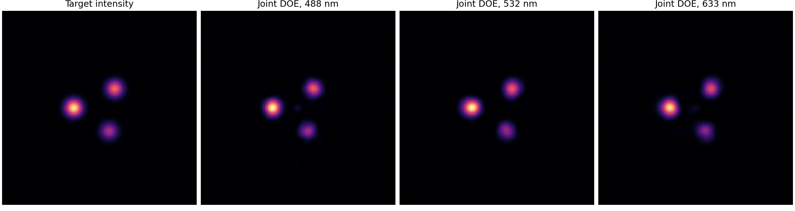
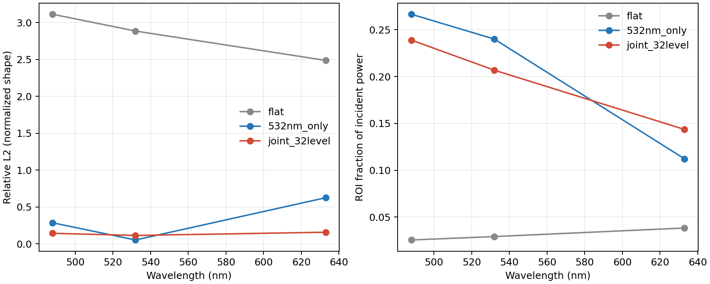
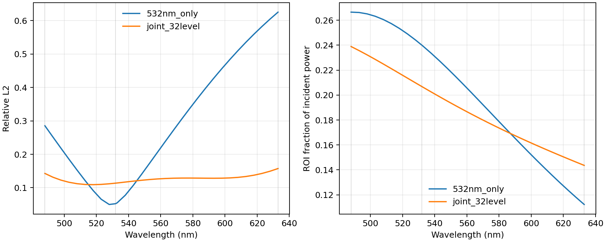
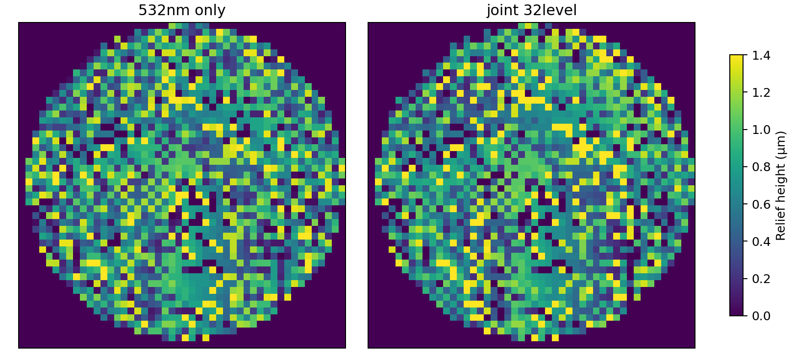

# 共享高度衍射器件的多波长同图案设计与数值验证

**课题文件夹：** `chromatic_doe_study`  
**日期：** 2026-10-12

## 摘要

本报告综合两项已有工作，并进一步验证：一张由真实材料高度浮雕构成的静态 DOE，能否在不同可见光波长下把预先指定的二维强度图案重建到同一物理探测面。前一项 Fourier 光学项目建立了从复场逆变换、Gerchberg–Saxton 强度相位恢复到材料色散、连续高度优化及宽带扫描的流程；较成熟的 RGB DOE 项目则以角谱传播和共享 S1813 高度为核心，开展了 126 组 RGB 消色散损失消融，并发现图案一致性、目标效率和背景之间存在明显折中。两项工作都属于标量数值研究，尚未验证加工器件。

本次采用更严格的物理参数化：三种波长共享同一张 S1813 高度图，优化直接在共同的物理 Fourier 面坐标上进行，不给每个波长单独指定自由相位屏。目标为非对称三光斑，设计波长为 488/532/633 nm。程序比较平屏、仅按 532 nm 优化的单色 DOE 和带 32 级高度量化的多波长联合 DOE，并另行检查 16 级量化、10 nm 随机高度扰动及 488–633 nm 每 5 nm 的采样扫描。

在当前有限网格与理想薄透镜模型内，联合 DOE 的三色最大归一化形状相对 L2 为 0.157，三色 ROI 功率均高于 14.3% 的入射功率；532 nm 单色设计的红光 L2 为 0.625、ROI 功率为 11.2%。扫描 31 个波长点时，联合设计平均 L2 为 0.126，28 个非设计采样点的最大 L2 为 0.149。结果支持“针对已知目标和指定波段，可以通过物理高度的多波长联合设计得到近似共图案”，但不支持对任意目标、任意波段或任意效率门槛的精确保证。

## 1. 问题界定

“任意设定衍射图案”需要理解为：给定一个非负二维目标强度、有限孔径、工作波段和误差/效率指标后，为这一个目标设计一张 DOE。它不表示同一张 DOE 能对无限多目标都准确成像。衍射系统的有限孔径、数值孔径、像素采样和被动透射约束限制了可达空间带宽；强度目标没有指定相位，因此反问题是非凸相位恢复问题，GS 类算法能寻找近似解，却不提供普遍精确可行保证 [1,4,5]。

在 Fourier 焦面，位置满足 X = λ f f_x。普通固定焦距会令空间频率对应的位置随波长缩放；选择合适的消色差中继或色散设计可补偿一部分坐标缩放，但“坐标对齐”不等于 DOE 材料相位、衍射效率和背景也对齐。高度浮雕的复透射率近似为

\[
t_\lambda(x,y)=P(x,y)\exp\!\left[i\,2\pi\frac{n(\lambda)-n_{\rm air}}{\lambda}h(x,y)\right],
\]

其中同一个物理高度 h(x,y) 必须供所有波长共用。多波长 DOE 文献已把共享高度作为优化变量并讨论离散高度和制造误差 [2,3]。

**结论先行：** 经过光学系统与 DOE 联合设计，可以在有限波段和指定容差内逼近同一个任意给定图案；“所有任意图案、严格完全相同、同时高效率”的一般承诺不成立。需要明确图案、波段、孔径/NA、最低 ROI 效率和制造尺度后，才能判断具体器件是否可行。

## 2. 对已有两项工作的总结

### 2.1 “多波长 Fourier 光学”项目

该项目由步骤 1–10 和后续 step 11 组成，覆盖了基础物理到逆向设计的连续路线：

- Step 1–3 比较任意复场与强度目标：匹配离散 Fourier 网格上的复场可以逆变换重建；仅给强度时要靠 GS 相位恢复，三光斑、圆环和字母 A 只能近似实现。
- Step 4–7 说明普通固定焦距产生波长相关尺度；理想指定 f(λ) ∝ 1/λ 可使 λf 恒定，但幅度共识启发式对 RGB 平均误差的改善很小，并牺牲参考绿光误差。
- Step 8–10 将屏改为熔融石英高度浮雕，加入 Sellmeier 色散后直接优化同一高度图 [7]。连续高度优化把三色平均相对 L2 从 0.299 降到 0.186；加 ROI 软约束后平均 L2 回升到 0.253，而三色 ROI 仍未都达到 0.85。多起点只找到最低 ROI 约 0.81–0.83 的局部解，400–700 nm 扫描显示只在 RGB 设计点优化不足以保证带边性能。
- Step 11 固定焦距、孔径和物理观察坐标，比较自由相位、共享自由复屏和随波长变化的 Chebyshev 复屏。自由的二阶光谱屏在训练波长上对三光斑/圆环达到约 1.5×10⁻³ 的残差，但模型放开了逐波长复透射率，不能等同于一张被动材料 DOE；字母 A 仍约 0.197。三波长训练也没有保证训练外表现。

该项目的重要贡献是明确区分复场可逆性、强度相位恢复、坐标缩放、材料色散及训练外误差。它同时揭示了一个模型边界：极低残差的“自由屏”只能当成参数化放松后的参考上界，不能作为物理器件结果。

### 2.2 “rgb-doe-optics-main”项目

这是更成熟的工程主线。其传播模型采用标量角谱 FFT，DOE 以共享的 S1813 物理高度表示，研究了单 DOE/双 DOE 光路、双波长与 RGB 目标、粗到细网格、材料色散、空间滤波和评价指标 [2,3]。多波长 SLM 全息工作提供了可编程系统对照，但并非静态高度 DOE [6]。

- 第一阶段用单缝/多缝建立固定屏幕坐标下的颜色缩放对照。第二阶段搜索不同波长的不同光栅级次，使 (m\lambda) 接近，从而让 RGB 主峰共定位；该策略适合有限峰或光栅，但不是任意二维图案的完整解，且未选取的其他级次会形成串扰。
- 主报告验证了传播实现和坐标约定，并比较圆斑、十字、圆环等目标。正式消融包括 7 种损失、3 类目标、2 种光路和 3 个随机种子，共 126 次。增加跨波长像素一致性和绝对能量一致性后，6 个目标/光路单元的共同尺度 ROI Pearson 全部提升，例如圆环单 DOE 从 0.237 到 0.994，十字单 DOE 从 0.832 到 0.999；RGB ROI 能量 CV 下降约 79%–98%。
- 一致性提升有代价：full 变体的平均背景相对 baseline 在六个单元上增加约 0.023–0.076。双 DOE 能改善部分位置和能量指标，但不是所有目标都降低背景或提高 ROI 效率。

该项目比单纯对比归一化图案更成熟，因为它同时追踪组件质心、ROI 效率、背景和共同色标一致性；主要限制是仍为标量计算，没有加工/实测验证、完整实测色散、矢量电磁响应或真实系统公差。原报告也没有声称能普遍消色散任意目标。

### 2.3 两项工作的合并认识

| 已有证据 | 可支持的结论 | 不能据此推出 |
|---|---|---|
| Fourier 逆 DFT、GS 与自由屏优化 | 给定目标可作为数值优化目标；自由度放开后训练残差可以很低 | 任意强度都能由被动相位屏精确重建 |
| (m\lambda\) 高阶匹配、理想 (\lambda f) 映射 | 峰位或坐标比例可通过衍射级次/系统色散作补偿 | 主峰共定位就代表任意二维图案一致 |
| 材料高度 DOE 联合损失 | 可改善限定目标上的 RGB 形状/能量一致性 | 归一化相似度等于高绝对效率，或背景没有增加 |
| 宽带扫描、多起点和双 DOE 比较 | 能发现带外退化、起点敏感和目标难度差异 | 局部优化未找到即证明严格不可行 |

## 3. 更成熟的设计方法

建议把任务建模为“具体目标、具体系统、具体制造工艺下的鲁棒逆设计”，而不是先假设某种光学器件一定能消掉色散。

1. **先锁定物理坐标与光路。** 使用相同的 X,Y 像面坐标评价所有波长。把 DOE 到镜头、孔径、焦距或像面距离放入前向模型；若采用衍射透镜或色散补偿中继，应把它的 f(λ) 纳入模型，而不要在后处理中对每个波长独立缩放图像。
2. **以一个共享高度作为核心设计变量。** 使用实测材料色散优先；本阶段沿用 S1813 文献折射率，并采用 (n(\lambda)=A+B/\lambda^2) 的两锚点 Cauchy 近似 [2]。让所有波长的相位都由同一高度图生成。
3. **联合优化形状、一致性和绝对能量。** 对输出形状使用固定探测窗口内的归一化误差，同时单独计算不经过窗口归一化的 ROI 入射功率比例。优化最差波长形状，并惩罚跨波长像素差异；对最低 ROI 效率使用约束/增广拉格朗日，而不是只最大化 Pearson。
4. **把制造约束提前纳入。** 加入高度上下界、灰阶量化、最小特征/高度斜率或平滑项，并在优化后按实际离散高度重新传播。比较独立高度误差和折射率误差，不能只展示连续高度解。
5. **密集训练、独立验证。** 设计波长覆盖应用谱段，不只取 RGB 三个点；对没有参与优化的波长、初值和加工误差进行留出测试。多起点报告训练误差分布，防止单个局部解被误称为最好可达性能。
6. **逐级升级光学模型。** 先做标量角谱/Fourier 逆设计；确定真实镜头、NA 和工作距离后再用 Zemax OpticStudio 的 Physical Optics Propagation 对同一相位/高度图逐波长复算；当特征接近波长、偏振或衍射级次效率重要时，用 RCWA/FDTD 校准 DOE 单元响应，再回填系统级传播。

本次程序实现其中的共享 S1813 高度、同一物理观察坐标、波长最差形状损失、ROI 效率下限软惩罚、32 级离散高度、粗糙度惩罚、单色/联合对照、留出光谱、16 级量化和 10 nm 高度噪声检查。当前的效率下限是**软惩罚**，不是硬可行性证明；最小特征制造约束也仍需进一步加强。

## 4. 本次数值模型

### 4.1 前向传播

DOE 后焦平面采用离散 Fraunhofer 积分，在固定的物理探测坐标上直接求场：

\[
U_\lambda(X,Y)=\frac{\Delta x^2}{i\lambda f}
\sum_{x,y}P(x,y)\exp\!\left[i2\pi\frac{(n(\lambda)-1)h(x,y)}{\lambda}\right]
\exp\!\left[-i2\pi\frac{xX+yY}{\lambda f}\right].
\]

其中 P 是圆形入瞳；同一个 h(x,y) 用于三个设计波长。S1813 折射率使用项目既有文献锚点 n(532 nm)=1.6482、n(633 nm)=1.6347；488 nm 由 Cauchy 模型外推，因此这一通道是模型预测值，不是直接锚点 [2]。

### 4.2 目标和损失

目标是一组三个不对称高斯斑，中心分别为 (-320,0)、(190,240)、(120,-290) μm，权重为 1:0.72:0.48，标准差 72 μm。探测面固定为 128×128、视场约 2.4 mm；DOE 网格为 48×48、6 μm 采样、140 μm 入瞳半径；焦距设为 50 mm 的**理想消色差薄透镜**。程序每个训练像素直接评价同一个毫米坐标，不把不同波长的 FFT 数组索引混作相同物理位置。

将每个波长的探测图归一化为 p_lambda = I_lambda / sum_detector(I_lambda)，目标 p_target 也在同一窗口归一化；图案项是两者的相对 L2，另用平滑最大值提高最差波长权重。绝对目标 ROI 效率为

\[
\eta_\lambda=\frac{\Delta X\Delta Y\sum_{(X,Y)\in ROI}I_\lambda(X,Y)}{P_{\rm in}},
\]

其中 P_in 是 DOE 入瞳的入射功率。ROI 定义为目标强度超过峰值 8% 的区域。总损失另含波长间归一化强度差、max(0, 0.12−eta_lambda)^2 效率短缺项及相邻高度差平方项。窗口内强度归一化只用于形状比较；ROI 效率仍以入射功率为分母，未按窗口内功率重归一化。

连续高度变量用 Adam 更新，前向传播使用 32 级均匀高度量化，并以 straight-through 梯度估计进行优化。532 nm 单色设计由两个随机初值选择较好者；三波长设计从该单色解和两个随机初值分别继续优化，最后保留联合训练目标较低者。当前运行使用 140 次迭代、CPU。它是受限模型的有限预算设计，不是全局最优解。

## 5. 结果

### 5.1 三色设计点对照

表中 L2 基于探测窗口内各自单位总和的强度；Pearson 只在 ROI 内计算；ROI 效率是目标区捕获的**入射功率比例**，不含真实界面反射、吸收或散射。

| 设计 | 波长 | 形状相对 L2 ↓ | ROI Pearson ↑ | ROI/入射功率 ↑ |
|---|---:|---:|---:|---:|
| 532 nm 单色 DOE | 488 nm | 0.285 | 0.916 | 0.267 |
| 532 nm 单色 DOE | 532 nm | 0.052 | 0.998 | 0.240 |
| 532 nm 单色 DOE | 633 nm | 0.625 | 0.555 | 0.112 |
| 三波长联合 DOE，32 级 | 488 nm | 0.143 | 0.995 | 0.239 |
| 三波长联合 DOE，32 级 | 532 nm | 0.114 | 0.991 | 0.207 |
| 三波长联合 DOE，32 级 | 633 nm | 0.157 | 0.990 | 0.144 |
| 三波长联合 DOE，16 级后量化 | 488 nm | 0.180 | 0.989 | 0.234 |
| 三波长联合 DOE，16 级后量化 | 532 nm | 0.132 | 0.989 | 0.206 |
| 三波长联合 DOE，16 级后量化 | 633 nm | 0.192 | 0.982 | 0.144 |

联合设计把三色平均相对 L2 从 0.321 降至 0.138，最大单色误差从 0.625 降至 0.157。最差波长 ROI 效率从单色设计的 11.2% 提升到联合设计的 14.4%；将 32 级设计再次量化到 16 级后，平均 L2 为 0.168，最低 ROI 效率为 14.4%。这些是当前理想无损标量模型中的功率比例，不能直接解读为现实 DOE 的总透射率或工作衍射级次效率。

### 5.2 带外和制造敏感性

对 488–633 nm 共 31 个波长点（5 nm 间隔，并纳入 532 nm 训练线）传播同一张固定高度图。联合设计平均 L2 为 0.126，最大为 0.157；28 个非训练采样点平均 L2 为 0.125，最大为 0.149。532 nm 单色设计在相同扫描点平均 L2 为 0.288，最差为 0.625。离散扫描未证明波段内每个连续波长均满足这些界限。

32 级高度解再被直接量化为 16 级，平均 L2 从 0.138 升至 0.168，最低通道 ROI 效率仍为 14.4%。在量化高度后叠加标准差 10 nm 的独立像素高度误差、用三个随机种子复算，三次最大 L2 分别为 0.166、0.164、0.159，最低 ROI 效率分别为 14.3%、14.2%、14.3%。这是小样本参数扰动检查，不代表统计制造良率。

量化图的相邻像素高度跳变量 95 百分位约为 1.13 μm，最大为 1.4 μm；当前平滑正则尚未给出可直接投产的最小特征/侧壁坡度保证。这一实测数值是下一步把工艺约束转为可微损失或几何滤波的依据。

### 5.3 数值自检

程序内置三个可复现检查：

| 检查 | 相对误差 |
|---|---:|
| 直接矩形 Fourier 积分 vs. 匹配 DFT 网格 | (1.60\times10^{-15}) |
| 损失方向梯度 vs. 中心有限差分 | (8.22\times10^{-10}) |
| DFT 网格离散 Parseval 能量关系 | 0 |

这些检查验证代码的离散算子、梯度和能量归一化，不验证真实透镜，也不代替全波电磁计算。完整运行参数和随机起点目标值保存在 [summary.json](results/summary.json)，逐波长结果在 [metrics.csv](results/metrics.csv) 与 [spectral_scan.csv](results/spectral_scan.csv)。

## 6. Zemax 与全波仿真的定位

本次没有运行 Zemax：现有任务没有指定真实镜头处方、工作距离、光阑/NA、基底、探测器尺寸与采样，也没有选定将 DOE 做成浮雕、复合 DOE 还是纳米结构；若在缺少这些输入时搭一个任意镜头模型，输出会增加模型细节，却不能验证用户目标。当前的理想 50 mm 消色差薄透镜适合作为第一轮逆设计参照。

确定实际结构后，可把该高度图作为 OpticStudio 的相位/衍射面，使用 Physical Optics Propagation 在各波长和相同探测器物理坐标上复算；需要纳入真实镜头像差、孔径和离焦。若设计的局部台阶或单元接近波长，或要求确定绝对衍射效率，则以 RCWA/FDTD 得到波长/偏振相关复透射系数，再耦合回系统级传播。标量 Fourier/角谱结果不能取代这两级验证 [1,2]。

## 7. 结论和后续工作

1. 已有工作证明了多波长强度反演可以被程序化，但也显示训练点、归一化指标和理想坐标补偿很容易掩盖实际器件约束。
2. 当前共享 S1813 高度设计在同一物理焦面近似形成同一个非对称三点目标，并在三色训练点、离散带内扫描、16 级量化和小幅高度误差下保持了相近形状。
3. 结论限于本目标和 (488\text{–}633\) nm 采样带，不能据此宣称“任意设定图案均严格实现”。高度跳变的尾部、理想薄透镜、材料外推和无损标量假设仍是明显边界。
4. 下一轮应在真实器件参数确定后，把表面最小特征/平滑与绝对效率门槛做成硬约束或增广拉格朗日目标；用实测 S1813 色散和更密带宽点重新优化，并将最终高度图导入 Zemax POP。亚波长单元再接 RCWA/FDTD。

## 8. 复现与文件

在课题目录下执行：

    python -m pip install -r chromatic_doe_study/requirements.txt
    python chromatic_doe_study/chromatic_doe.py --self-test-only
    python chromatic_doe_study/chromatic_doe.py --output chromatic_doe_study/results --iterations 140 --starts 2 --device cpu

主程序为 [chromatic_doe.py](chromatic_doe.py)。所有表格和图片均由本脚本生成；不依赖 Zemax、PyOptica 或已有工程的运行时代码。

## 参考文献

[1] J. W. Goodman, *Introduction to Fourier Optics*, 3rd ed., Roberts & Company Publishers, 2005.

[2] G. Kim, J. A. Domínguez-Caballero, and R. Menon, “Design and analysis of multi-wavelength diffractive optics,” *Optics Express*, 20(3), 2814–2823 (2012). [DOI: 10.1364/OE.20.002814](https://doi.org/10.1364/OE.20.002814).

[3] M. Chen, C. Wang, Y. Gu, and Q. Tan, “Diffractive optical element with same diffraction pattern for multicolor light-emitting diodes,” *Applied Optics*, 55(1), 159–165 (2016). [DOI: 10.1364/AO.55.000159](https://doi.org/10.1364/AO.55.000159).

[4] R. W. Gerchberg and W. O. Saxton, “A practical algorithm for the determination of phase from image and diffraction plane pictures,” *Optik*, 35(2), 237–246 (1972).

[5] J. R. Fienup, “Phase retrieval algorithms: a comparison,” *Applied Optics*, 21(15), 2758–2769 (1982). [DOI: 10.1364/AO.21.002758](https://doi.org/10.1364/AO.21.002758).

[6] D. Bowman, P. Ireland, G. D. Bruce, and D. Cassettari, “Multi-wavelength holography with a single spatial light modulator for ultracold atom experiments,” *Optics Express*, 23(7), 8365–8372 (2015). [DOI: 10.1364/OE.23.008365](https://doi.org/10.1364/OE.23.008365). This is a programmable SLM route, not a static DOE material model.

[7] I. H. Malitson, “Interspecimen comparison of the refractive index of fused silica,” *Journal of the Optical Society of America*, 55(10), 1205–1209 (1965). [DOI: 10.1364/JOSA.55.001205](https://doi.org/10.1364/JOSA.55.001205).

## 本地前序成果

- [RGB DOE 主报告源文件](../rgb-doe-optics-main/report/rgb_doe_honors_report.tex) 与 [PDF](../rgb-doe-optics-main/report/rgb_doe_honors_report.pdf)
- [多波长 Fourier 光学综合结论](../多波长%20Fourier%20光学/fourier_optics_final_synthesis.md)
- [Step 11 固定坐标自由屏报告](../多波长%20Fourier%20光学/fourier_optics_step11_report.md)
- [多波长 Fourier 仿真接口说明](../多波长%20Fourier%20光学/fourier_optics_framework_README.md)
