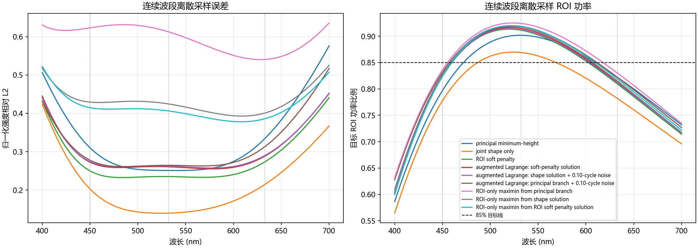

# Step 10：起点敏感性、ROI 门槛与 400–700 nm 波段检查

## 研究问题

Step 9 的连续高度优化把三色平均图案误差降低了，但目标 ROI 功率下降；加入软惩罚后仍未让三色 ROI 全部达到 0.85。本步检查优化结果对起点是否敏感、只最大化 ROI 能否达到门槛，以及 450/532/633 nm 设计在较密连续波段采样中的表现。

## 设置

- 沿用 1024×1024 三光斑目标、5 μm 输入采样、熔融石英 Sellmeier 色散和理想 `f(λ)=f₀λ₀/λ` Fourier 算子。
- 连续高度仍限于 `0≤h/h₂π≤3`，`h₂π=1.15475 μm`。
- 目标 ROI 定义为目标强度达到峰值 1% 的像素。
- 增广拉格朗日优化以三波长归一化图案误差和 ROI 短缺为目标，3 个起点分别是 Step 9 软惩罚解、形状解加 0.10 个 `2π` 高度周期扰动、主值高度加同等扰动；每个起点 4 轮外层乘子更新、每轮 25 步 Adam。
- ROI-only 对照使用平滑最小值目标最大化 450、532、633 nm 中最差 ROI 功率，每个起点 120 步 Adam；分别从主值高度、形状解、ROI 软惩罚解开始。
- 对 400–700 nm 按 5 nm 扫描，共 61 点。对每个固定高度图计算 Sellmeier 色散后的浮雕透射率；所有输出使用人为指定的理想逆波长焦距补偿。

## 起点与 ROI 结果

| 方案 | 450 nm：L2 / ROI | 532 nm：L2 / ROI | 633 nm：L2 / ROI | 平均 L2 | 最低 ROI |
|---|---:|---:|---:|---:|---:|
| Step 9 连续形状解 | 0.2025 / 0.7776 | 0.1397 / 0.8691 | 0.2149 / 0.7817 | 0.1857 | 0.7776 |
| Step 9 ROI 软惩罚解 | 0.2498 / 0.8238 | 0.2350 / 0.9114 | 0.2737 / 0.8094 | 0.2528 | 0.8094 |
| 增广拉格朗日：主值扰动起点 | 0.2777 / 0.8317 | 0.2644 / 0.9176 | 0.3134 / 0.8220 | 0.2852 | 0.8220 |
| ROI-only maximin：主值起点 | 0.6229 / 0.8361 | 0.6127 / 0.9242 | 0.5405 / 0.8300 | 0.5919 | 0.8300 |

其余两个增广拉格朗日起点的平均 L2 分别为 0.2756、0.2739，最低 ROI 为 0.8113、0.8132；结果彼此接近，说明这几种局部起点都会停在 0.81–0.83 左右，而不是达到设定的 0.85。ROI-only 另两种起点的最低 ROI 为 0.8149、0.8188，平均 L2 分别为 0.4182、0.4023。结果呈现清楚的精度折中：提高最差色 ROI 的解，图案误差明显上升。

**解释限制：** 这是三个有限起点、连续像素高度、有界非凸 Adam 优化；未遍历可行集合，也未加高度平滑、最小特征或量化。因而它只能说“本次搜索未找到同时达到 85% 的高度图”，不能证明 85% 在当前模型中绝对不可行。另一方面，ROI-only 解的平均功率可以超过 85%，但最低色仍不足；看三色平均值会掩盖单色失配。

## 连续波段结果

| 固定高度设计 | 400–700 nm 平均 L2 | 最差采样 L2 | 最差 L2 波长 | 平均 ROI | 最低 ROI | 最低 ROI 波长 |
|---|---:|---:|---:|---:|---:|---:|
| 主值最小高度 | 0.3324 | 0.5762 | 700 nm | 0.8193 | 0.5864 | 400 nm |
| 形状优化 | 0.2134 | 0.4238 | 400 nm | 0.7877 | 0.5642 | 400 nm |
| ROI 软惩罚 | 0.2792 | 0.4409 | 700 nm | 0.8241 | 0.6037 | 400 nm |
| ROI-only maximin（三色点） | 0.5949 | 0.6357 | 700 nm | 0.8409 | 0.6317 | 400 nm |

针对三色点作的优化明显偏离 400–700 nm 两端。ROI-only 解在设计波长附近试图均衡目标能量，连续波段端点的最低 ROI 仍只有 0.632。该结论限于 5 nm 离散采样和当前材料/浮雕模型；由于抽样波长有限，它不是数学上的连续波段上界。对相同 q 高度在各波长重算是必要的，但理想逆波长焦距并非一块已建模的真实透镜。

图中左侧是归一化强度 L2，右侧是 1% 目标 ROI 功率；虚线标记 85% 门槛，竖线标记三个设计波长。

## 本步结论

1. 多起点/增广拉格朗日与 ROI-only maximin 都未在此次有限搜索中使三色最低 ROI 达到 0.85；这不构成不可行性证明。
2. 单看 ROI 提高能量集中会以更大的形状误差为代价，目标函数需要同时写明形状误差和最低波长功率。
3. 只在三个可见光波长训练不足以保证较宽波段。此主值浮雕在 400 nm 的 ROI 仅约 0.59–0.63，700 nm 的误差也普遍上升。
4. 当前结果已足以回答抽象模型问题并说明模型内的取舍；实际器件研究还需要具体结构、NA、制造尺度与绝对效率要求，后续应使用对应电磁求解/实验数据。

## 产物

- `fourier_optics_step10_robustness.py`：起点扰动、增广拉格朗日、ROI-only maximin 和波段扫描。
- `fourier_optics_step10_results.json`、`fourier_optics_step10_results.npz`：设计、波段和指标数组。
- `fourier_optics_step10_band_robustness.png`：波段图案误差和 ROI 功率曲线。
- `fourier_optics_step10_run.log`：脚本运行记录。
