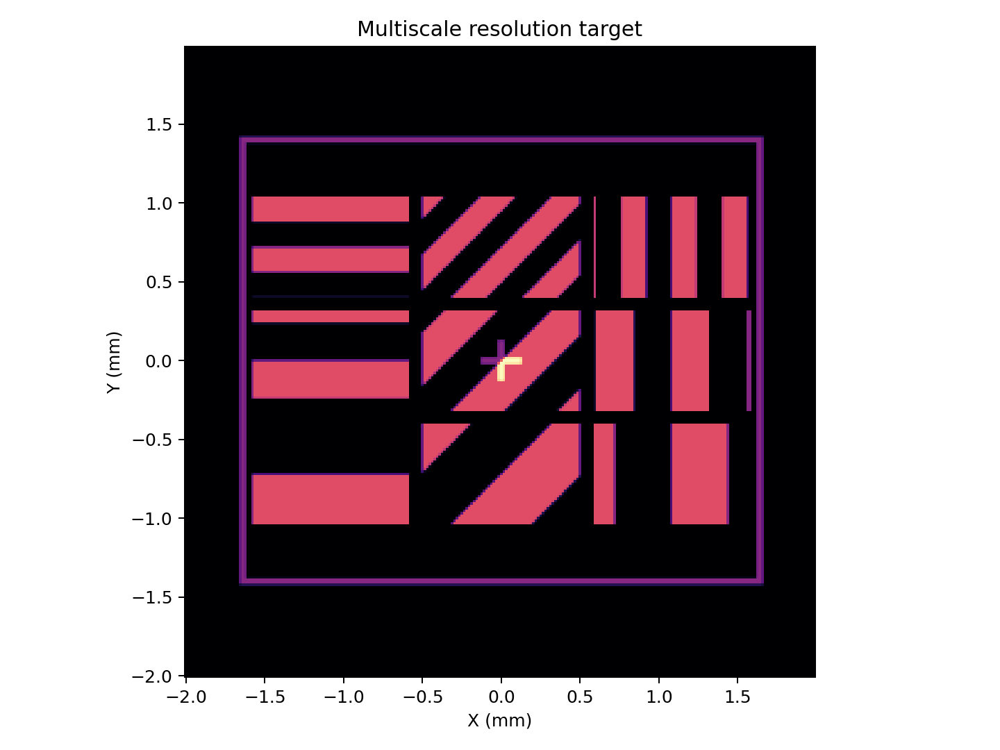
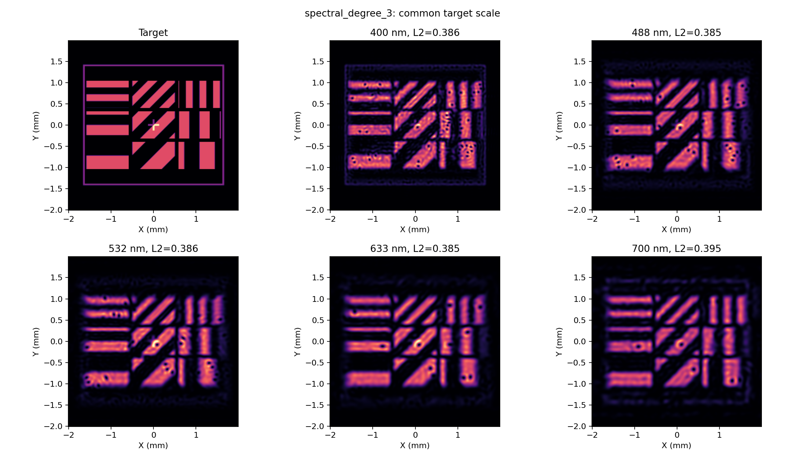

# 可见光全波段多尺度联合设计实验

固定 Step 11 孔径、焦距和自由复屏模型，对 400–700 nm 做 1 nm 验收；380–780 nm 为压力测试。初始训练包含 34 个波长，损失包含 70/30 平均与最差 10% 相对 L2² 稳健项，以及 ROI=0.80 的效率下限惩罚。主目标执行了两轮自适应补点，每轮加入六个波长；圆环作控制组。

设计波段的验收要求全部 301 个点均满足相对 L2≤0.10 且 ROI 功率比例≥0.80。

## 多尺度分辨率目标

| 模型 | 平均 L2 | P95 L2 | 最大 L2（波长） | 最小 ROI | 设计波段通过 | 压力段最大 L2（波长） | 压力段最小 ROI |
|---|---:|---:|---:|---:|:---:|---:|---:|
| 二阶 | 0.44577 | 0.45147 | 0.45356（700 nm） | 0.69705 | 否 | 0.82316（780 nm） | 0.36829 |
| 三阶（两轮补点后） | 0.38411 | 0.38642 | 0.39549（700 nm） | 0.75231 | 否 | 0.79035（780 nm） | 0.38386 |

二阶初始参数数为 30,150，三阶为 40,200，增加 33.3%。三阶在设计波段的平均误差比二阶低约 13.8%，最低 ROI 比例提高约 0.055；但误差仍远高于 0.10，最低 ROI 也低于 0.80，所以不能称为全可见光达标。三阶区域 Pearson 相关性：160/240/360 µm 线宽平均分别为 0.8769/0.9127/0.9155；0°/45°/90°方向平均分别为 0.9206/0.9256/0.8588。相关性较高表示空间形状相似，不代表绝对误差和能量门槛通过。

自适应补点为：第 1 轮加入 416、446、451、464、514、562 nm；第 2 轮加入 435、474、479、526、555、651 nm。所有 1 nm 扫描仍显示 700 nm 附近为最差误差区；在当前自由度、固定光路和损失权重下，继续只在峰值附近补点不能解决目标本身的宽带拟合差距。

目标预览：

三阶代表性波长输出与目标共尺度对照：

## 圆环控制组

| 模型 | 平均 L2 | P95 L2 | 最大 L2（波长） | 最小 ROI | 设计波段通过 | 压力段最大 L2（波长） | 压力段最小 ROI |
|---|---:|---:|---:|---:|:---:|---:|---:|
| 二阶 | 0.078602 | 0.092610 | 0.093790（400 nm） | 0.95778 | 是 | 0.32463（780 nm） | 0.81806 |
| 三阶 | 0.011048 | 0.032083 | 0.040341（400 nm） | 0.99172 | 是 | 0.15682（780 nm） | 0.88328 |

圆环控制组在 400–700 nm 对二阶和三阶均通过双门槛；范围外压力测试在 780 nm 出现更大的图像误差，但 ROI 功率仍高于 0.80。它确认本次固定光路和优化流程能拟合较简单的圆环目标，多尺度图的失败与目标复杂度和当前有限光谱自由度有关。

## 实验设置与解释边界

- 屏面使用 320×320 采样，观察面保持 256×256、15.625 µm 像素和约 4 mm 视场；屏面采样通过 380 nm Nyquist 检查。孔径物理尺寸和焦距沿用 Step 11。
- 训练初始波长为 400–700 nm 每 10 nm，加 488、532、633 nm。三阶模型以二阶解零扩展初始化；每个阶数 3 个起点、每个起点最多 400 次迭代。
- 所有 1 nm 验证图保存在 `multiscale/spectral_degree_2/spectral_scan_images.npy`、`multiscale/spectral_degree_3/spectral_scan_images.npy` 以及圆环对应目录。逐波长误差、ROI、分区 Pearson 见各 case 的 `metrics.csv` 和 `results.json`。
- 代码及损失梯度、目标采样、CVaR 分数边界、自适应选点和检查点恢复测试通过；全工程 51 项单元测试通过，扫描强度数组无 NaN/Inf。

自由复屏系数不是可加工的被动材料器件，ROI 比例不是现实器件效率。结果来自标量、点采样 Fourier 透镜模型；1 nm 扫描是密集离散验证，不构成连续波段的数学证明。
